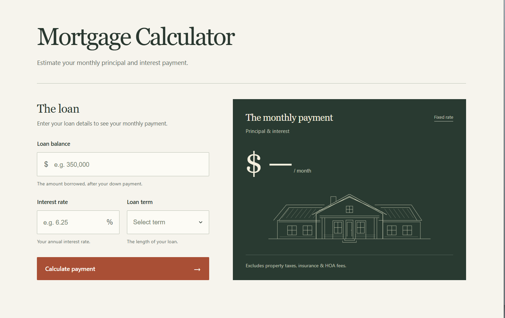
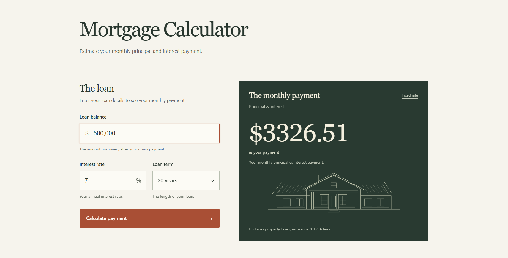

# Mortgage Calculator

A React application that estimates the monthly principal and interest payment for a fixed-rate mortgage using a loan balance, annual interest rate, and a 15- or 30-year term.

I built this project to practice React state management and conditional rendering, then used AI to explore its visual design while preserving the calculation logic. Reviewing and modifying the generated CSS was a serious bonus and helped me understand all of the little pieces that go into a production ready website.

**Stack:** React 18, JavaScript, Vite, CSS, inline SVG, Vitest, and React Testing Library.

**Screenshots**






## Running locally

Install dependencies and start the development server:

```bash
npm install
npm run dev
```

## State management with `useState`

The application keeps its calculation inputs and UI state inside the `App` component:

```jsx
const [principal, setPrincipal] = useState(0);
const [monthlyPayment, setMonthlyPayment] = useState(0);
const [clicked, setClicked] = useState(false);
const [edited, setEdited] = useState(false);
```

Each call returns a state value and its setter. React preserves those values between renders, calling a setter schedules the component to render with the updated state.

## Conditional rendering

In doing this project I learned ternary conditional rendering and my favorite, using multiple and statements to return code. I was mind blown to realize that you can return anything, not just booleans using && in JavaScript allowing you to very easily render code if all of the previous conditions are true without any if statements!

### Ternary: render one of two results

```jsx
{clicked ? (
  <p className="payment" data-testid="output">
    <span className="payment-value">${monthlyPayment.toFixed(2)}</span>
    <span className="payment-caption"> is your payment</span>
  </p>
) : (
  <p className="payment placeholder-payment">
    $<span>—</span>
    <span className="per-month"> / month</span>
  </p>
)}
```

### Chained `&&`: render only when every condition passes

```jsx
{clicked && edited && (
  <p className="result-status">
    Details changed. Calculate again to update your estimate.
  </p>
)}

{clicked && !edited && (
  <p className="result-status">
    Your monthly principal &amp; interest payment.
  </p>
)}
```

## Calculation and input handling

The calculation uses the fixed-rate amortization formula:

```text
M = P × [r × (1 + r)^n] / [(1 + r)^n − 1]

P = principal
r = annual interest rate / 12 / 100
n = loan term in years × 12
M = monthly principal and interest payment
```

The existing implementation stores the numeric result in `monthlyPayment` and uses `.toFixed(2)` when rendering it. That formats the displayed payment to two decimal places without rounding the intermediate calculation.

## The design prompt

The design experiment was inspired by a technique Anshu Chimala described in a Substack post: generate a random alphanumeric string and use its internal patterns as creative inspiration for an AI-generated interface.

https://substack.com/home/post/p-213056760

My prompt first established the constraint: build the UI, preserve the calculations, and keep the existing tests passing. It then gave this procedure:

> 1. Generate a long, random alphanumeric string using a shell script.
> 2. Define the creative direction (color scheme, layout, typography, etc.) based on the string. Look beyond the surface for subpatterns, special numbers, anything that inspires you.
> 3. Use your judgment to bring this direction to life and make it look great.
>
> Don't reveal the string in the design. It's only for your inspiration.

The string was a design input, not application data or a reproducible design specification. It helped establish a direction around warm ivory, forest green, terracotta, serif headings, and architectural linework.

I treated the generated interface as a starting point. I removed the header, footer, and explanatory section to keep the calculator focused, then reviewed and experimented with the CSS. That process let me retain ownership of the result while using AI to accelerate exploration and learning.

### Selection, focus, and hover

These small rules were a major part of what I learned by inspecting the generated stylesheet:

```css
/* Changes the colors of the text and background when highlighted/selected */
::selection {
  color: #fff;
  background: #a84d32;
}

/* Highlights the text input box that's selected  */
.input-wrap:focus-within {
  border-color: #a94e34;
  box-shadow: 0 0 0 3px #b4533515;
}

/* Changes the color of the button when hovering over it */
.calculate-button:hover {
  background: #8b3e28;
}
```

